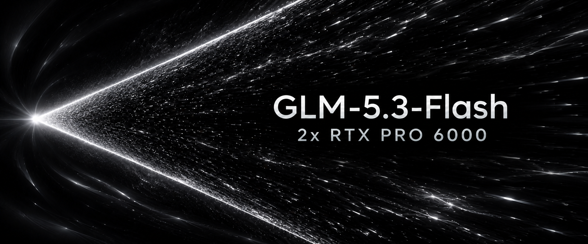

<h1 align="center">GLM-5.3-Flash EXL3 on 2x RTX PRO 6000 with TensorFold's native engine</h1>

<p align="center">
  
</p>

<p align="center">
  <sub>by <a href="https://x.com/MiaAI_lab">Mia's AI Lab</a></sub>
  <br><br>
  <a href="https://github.com/sponsors/MiaAI-Lab" target="_blank" rel="noopener noreferrer" style="display:inline-block;margin:0 8px;vertical-align:middle;"></a>
  <a href="https://x.com/MiaAI_lab" target="_blank" rel="noopener noreferrer" style="display:inline-block;margin:0 8px;vertical-align:middle;"></a>
</p>

This recipe serves GLM-5.3-Flash from an EXL3 checkpoint on two local RTX PRO 6000 Blackwell GPUs, with tensor parallel 2
on one host. It uses TensorFold's native Zig/CUDA server (`tensorfold-native`) built in Docker. The default checkpoint
is the pinned 4 bpw EXL3 quant, downloaded on the first start and mounted read-only. One container runs both ranks: rank
0 serves the OpenAI-compatible API, and rank 1 follows its steps.

```sh
./start.sh            # check, build the image once, download the weights once, start both ranks, wait for the API, smoke-test
./stop.sh             # stop, archive the logs (logs/glm53-zig-*.tar.gz)
DRY_RUN=1 ./start.sh  # print the whole plan: docker build, both rank command lines, docker run, health wait, smoke test
```

The engine is TensorFold at commit `f350cd3e` ([ashhart/TensorFold](https://github.com/ashhart/TensorFold)), plus any
`patches/engine/*.patch`, compiled with Zig 0.17.0 for sm_120 by `docker/Dockerfile`.

## Performance

Official numbers for GLM-5.3-Flash on 2x RTX PRO 6000, with both cards capped at **400 W (400/400 W)**.

| Prefill, prompt tokens | 4K | 8K | 16K | 32K | 64K | 128K | 256K |
| --- | ---: | ---: | ---: | ---: | ---: | ---: | ---: |
| tok/s | 5,943.1 | 5,753.0 | 6,006.2 | 6,033.1 | 5,961.5 | 5,787.7 | 5,503.1 |
| TTFT | 753 ms | 1.49 s | 2.79 s | 5.49 s | 11.06 s | 22.71 s | 47.70 s |
| Prompt tokens counted | 4,129 | 8,220 | 16,414 | 32,802 | 65,564 | 131,103 | 262,179 |

| Decode (prose, temperature 0.7, thinking on) | 1 stream | 2 streams | 3 streams | 4 streams |
| --- | ---: | ---: | ---: | ---: |
| Total tok/s | 245.5 | 336.6 | 385.5 | 436.6 |
| tok/s per stream | 245.5 | 169.1 | 132.0 | 110.3 |
| TTFT | 54 ms | 74 ms | 99 ms | 122 ms |

## Requirements

- Linux x86_64 with two NVIDIA GPUs of 96 GB each (RTX PRO 6000 Blackwell, sm_120) and a driver for CUDA 13.
- Docker with the NVIDIA Container Toolkit, and BuildKit (the default builder). Your login must be in the `docker` group.
- `curl`, `python3`, `flock`, `tar`, `gzip`, `sha256sum` and `nvidia-smi` on the host. `hf` (`huggingface_hub[cli]`)
  for the downloads.
- The checkpoint: `start.sh` downloads the pinned `Mia-AiLab/GLM-5.3-Flash-EXL3-4bpw-TensorFold@76c0b517` (about 164 GiB)
  into `DATA_DIR/model` when it is missing, and an interrupted download resumes on the next start. To serve a directory
  you already have, with `config.json`, `tokenizer.json` and the safetensors shards, set `MODEL_SOURCE=local` and
  `MODEL_DIR`.
- For the default drafter, `incoai/GLM-5.3-Flash-DFlash2@bf582e4e` (CC BY-NC-ND 4.0, non-commercial). It is downloaded
  to `DFLASH2_DIR` when missing. For commercial use, set `DRAFTER=mtp` or `DRAFTER=none`.
- Disk: about 40 GiB for the image build, and 180 GiB free for the checkpoint. Host memory: the ranks stage each layer through host memory while they
  load, and `start.sh` warns below `MIN_HOST_FREE_GIB` (16) available.

The engine patches also serve mixed-width quants through `MODEL_SOURCE=local`, such as a 3.5 bpw one with 3-bit gate/up in
32 layers. Stock upstream reads only 4-bit `mcg` EXL3 experts: it refuses a `config.json` without
`quantization_config.bits: 4` and trellis tensors of another width. The `bits` check is handled by the recipe's config
overlay (`CONFIG_OVERLAY`, see below).

## Quick start

```sh
cp scripts/local.sh.example scripts/local.sh   # this host already has one
$EDITOR scripts/local.sh                        # GPUS, PARALLEL, ...
DRY_RUN=1 ./start.sh                            # read the plan
./start.sh
curl -s http://127.0.0.1:8020/v1/chat/completions -H 'Content-Type: application/json' \
  -d '{"model": "GLM-5.3-Flash", "messages": [{"role": "user", "content": "Hello"}]}'
```

`./start.sh restart` applies changed settings. `./start.sh` on a running server only waits for it and smoke-tests it.
`scripts/prepare.sh` builds the image and checks the weights without starting anything (`--image`, `--weights`), and
`scripts/prepare.sh --check` runs the GPU and peer-to-peer checks. `scripts/prepare.sh --label` prints the image hash.

The first start builds the image, which takes a few minutes with BuildKit's caches. Each rank also hashes every
checkpoint shard once, for the ranks' agreement check. That hash is cached in `CACHE_DIR` (the ranks' `HOME`), so later
starts only read and load the weights. `WAIT_TIMEOUT` (2400 s) covers both.

## How it starts

1. **Checks.** These cover Linux, Docker, the NVIDIA runtime, the lock (`.state/start.lock`), each GPU in `GPUS`
   (`MIN_GPU_FREE_MIB` free, under `MAX_GPU_USED_MIB` in use, no compute process of that size), host memory, disk, and
   the ports (`PORT` on `HOST`, plus `NCCL_PORT` and `NCCL_PORT+1` on loopback).
2. **Image.** `docker build -f docker/Dockerfile` runs with the repository root as context and build args `TF_REPO`,
   `TF_REF`, `ZIG_VERSION`, `ZIG_SHA256`, `SM` and `PATCHES_HASH`. `PATCHES_HASH` is a short sha256 over
   `docker/Dockerfile`, the `patches/engine/*.patch` files sorted by name, and the pins. The image is tagged
   `tensorfold-glm53-zig:<hash>` and labelled `tf.patches=<hash>`. The build is skipped when an image with that label
   exists. Editing scripts or docs never forces a rebuild.
3. **Weights.** Whatever is missing is downloaded with `hf`. The checkpoint is mounted read-only at `/model` and DFlash2 at `/dflash2`. For a mixed-width EXL3
   quant whose `quantization_config` has `avg_bits` but no `bits`, a copy of `config.json` with `bits: 4` added
   (`.state/model-config.json`) is mounted over `/model/config.json`. The checkpoint itself is never changed.
4. **Peer access.** NVML's peer-to-peer status for the two GPUs comes from `tensorfold-native capabilities --json`. It
   is a warning only: without P2P, NCCL falls back to slower paths.
5. **Launch.** One container (`glm53-zig`, `--network host --ipc=host`, running as your UID) runs
   `logs/run-*/runner.sh`, which starts the ranks. Rank 1 starts first and retries its connection to rank 0 for up to
   300 s.
6. **Ready.** `start.sh` polls `/health` until rank 0 listens, which happens only after every rank has loaded and the
   ranks agree. It then checks that `/v1/models` lists `SERVED_NAME` and sends a greedy smoke-test chat completion.

### Ranks and GPUs

`GPUS` lists GPUs in rank order: the first one listed runs rank 0. Rank 0 holds the HTTP server, the vision tower and
the rank-0 share of the heads, so it is the heavier rank. On this host GPU 1 also drives the desktop, so the default
`GPUS=0,1` puts rank 0 on GPU 0 and rank 1 on GPU 1. Keep rank 0 on the card without the desktop: with the monitors on
GPU 0, use `GPUS=1,0`.

Inside the container, the GPUs are numbered in PCI order (`CUDA_DEVICE_ORDER=PCI_BUS_ID`, the order of `nvidia-smi`
indices). Each rank's `CUDA_VISIBLE_DEVICES` lists its own GPU first and the other GPU after it, so `TF_CUDA_DEVICE=0`
opens its own GPU and NCCL can still use peer-to-peer and CUDA IPC. `TF_GLM_RANK` of `TF_GLM_WORLD` places each rank,
and `NCCL_COMM_ID=127.0.0.1:NCCL_PORT` names rank 0's address. Rank 0 also keeps a TCP line per follower on
`NCCL_PORT+1`. If any rank fails, the others stop. Both ranks get the same flags: before loading weights, the ranks
compare a fingerprint of their settings, the checkpoint and the binary. The command lines for `GPUS=0,1` are:

```sh
# rank 1 on host GPU 1
env CUDA_VISIBLE_DEVICES=1,0 TF_CUDA_DEVICE=0 TF_GLM_RANK=1 TF_GLM_WORLD=2 NCCL_COMM_ID=127.0.0.1:29583 \
  /usr/local/bin/tensorfold-native serve /model --name GLM-5.3-Flash --host 0.0.0.0 --port 8020 --context N \
  --parallel 4 --max-tokens 32768 --kv-cache fp8 --no-update-check --no-thinking --reasoning-effort high --vision \
  --drafter /dflash2 --drafter-bits 4
# rank 0 on host GPU 0: the same with CUDA_VISIBLE_DEVICES=0,1 TF_GLM_RANK=0
```

The container environment also carries `TF_GLM_DENSE_BITS`, `TF_GLM_HEAD_BITS`, `TENSORFOLD_MEMORY_RESERVE_GIB`,
`TF_GLM_CLEAR_THINKING`, `HF_HUB_OFFLINE=1`, `TENSORFOLD_NO_UPDATE_CHECK=1`, `NCCL_P2P_LEVEL=SYS`,
`NCCL_SOCKET_IFNAME=lo` and `NCCL_IB_DISABLE=1`. Any other `TF_*`, `TENSORFOLD_*` or `NCCL_*` variable you export is
passed to both ranks by name. `TENSORFOLD_API_KEY` is passed this way and never printed.

## Settings

Settings are layered: `scripts/config.sh` defaults, then `.env` (literal `KEY=value` lines), then `scripts/local.sh`
(trusted Bash, gitignored), then exported environment variables, which take precedence over everything else.

| Setting | Default | Meaning |
| --- | --- | --- |
| `MODEL_SOURCE` | `download` | `download`: fetch the pinned 4 bpw checkpoint into `MODEL_DIR` when it is missing. `local`: serve `MODEL_DIR` as it is, with no download |
| `ABLIT` | `0` | `1`: serve the gated [Ablit weights](#ablit-weights) instead of the published checkpoint; needs `HF_TOKEN` to download them |
| `HF_TOKEN` | unset | A Hugging Face read token for gated downloads. It is never passed to the ranks or printed |
| `MODEL_DIR` | `DATA_DIR/model` (`DATA_DIR/model-ablit` with `ABLIT=1`) | The EXL3 checkpoint, mounted read-only |
| `CONFIG_OVERLAY` | `auto` | `auto`: add `bits: 4` over `config.json` when an EXL3 config has none. `0`: mount `config.json` as stored |
| `DRAFTER` | `dflash2` | `dflash2` (`--drafter /dflash2`), `mtp` (the checkpoint's MTP head) or `none` (`--no-drafts`) |
| `DFLASH2_DIR` | `DATA_DIR/dflash2` | DFlash2 weights, downloaded at the pinned revision when missing |
| `DRAFTER_BITS` | `4` | `--drafter-bits`: `4`, or `0` for a bf16 drafter |
| `MTP_DRAFTS`, `MTP_CONFIDENCE` | empty | `--mtp-drafts N`, `--mtp-confidence F` |
| `GPUS` | `0,1` | GPU indices in rank order, two to four |
| `PARALLEL` | `4` | `--parallel`: concurrent streams. A number is admitted only if it fits. `auto` serves up to 8, as many as fit |
| `PREFILL_SHARE` | `0.68` | `TENSORFOLD_PREFILL_SHARE`: the share of wall time a long prompt's 2,048-row chunks get while other streams decode. Each chunk then owes the decoders `(1 - p) / p` of its own time in decode rounds before the next chunk runs. `1` gives them one round per chunk, so a chat beside a long prefill crawls; `0.68` gives them about ten (see [Prefill beside decoding](#prefill-beside-decoding)). Replies are the same at any value |
| `PREFILL_BUDGET` | empty | `TENSORFOLD_PREFILL_BUDGET`: at most this many prompt rows filled per visit while a stream waits to decode. Empty: no cap |
| `CONTEXT` | `auto` | `--context`, up to 1,048,576 tokens of prompt plus reply. `auto`: the largest that fits (see below) |
| `CONTEXT_MAX` | `1048576` | The first window `auto` tries |
| `CONTEXT_RETRY` | `1` | After a memory refusal, start once more with a window that fits |
| `CONTEXT_FIT_MARGIN` | `0.93` | Fraction of the computed window that the retry asks for |
| `KV` | `fp8` | `--kv-cache`: `fp8` (e4m3 caches, one window per stream) or `bf16` (exact, shared KV pages) |
| `KV_PAGES` | `on` | `TF_KV_PAGES`. `on`: every stream draws its KV from one shared pool of 512-row pages, and `CONTEXT` is one request's cap; a request that doesn't fit waits for pages. `off`: with `KV=fp8`, a fixed window per stream. fp8 on pages needs engine patches 0017–0025 |
| `CE_EXCHANGE` | `1` | `TF_GLM_CE_EXCHANGE`: prompt exchanges between the ranks by copy engines (same bits) |
| `ABSORB_MMA` | `0` | `TF_GLM_ABSORB_MMA`: prompt absorb_q/expand_v on tensor cores. Only the fp32 summation order changes, so replies are not byte-identical to `0` |
| `W8A8` | `0` | `TF_GLM_W8A8`: int8 activations in prompt dense GEMMs. A real rounding of activations: validate on your own eval before turning it on |
| `DENSE` | `q8` | Dense linears packed at load (`TF_GLM_DENSE_BITS`): `bf16` as stored, or `q8`/`q6`/`q4` (symmetric integer codes, groups of 64). `fp8` is accepted as `q8` |
| `HEAD` | `bf16` | The LM head, same choices (`TF_GLM_HEAD_BITS`) |
| `MEMORY_RESERVE_GIB` | `4` | `TENSORFOLD_MEMORY_RESERVE_GIB`: memory per GPU left out of the engine's budget (fractions allowed; 3.5 fits 4 streams on pages with the 4 bpw checkpoint) |
| `PROMPT_CACHE_GIB` | empty | `--prompt-cache-gib` for kept prompt states. Empty: up to 16 GiB of what the streams leave. `0`: none |
| `PROMPT_CACHE_MIN_GIB` | empty | The smallest prompt cache a start may serve with, in GiB a rank (device pages plus the pinned host tier, as rank 0's `prompt cache: ... a rank` line counts them). `start.sh` stops the server before LIVE (`E_CACHE`) when that start funds less: the cache is what the room leaves, so `PROMPT_CACHE_GIB` caps it but does not guarantee it. Empty: no check |
| `LEARN_GIB`, `LEARN_MIN_FREE_GIB` | `0`, `15` | `LEARN_GIB` > 0 keeps the prompt states on disk too, up to that many GiB (`--learn-conversations`, patch 0103); see [Memory](#memory-on-96-gb-discrete-cards-with-a-desktop-on-gpu-1) |
| `KV_SHARD` | `0` | `1` keeps each stream's latent rows on one GPU (`TF_GLM_KV_SHARD`, patch 0104): about 1.8x the tokens in the same memory; see [Memory](#memory-on-96-gb-discrete-cards-with-a-desktop-on-gpu-1). Needs two GPUs, `KV=fp8`, `KV_PAGES=on`, DFlash2 or no drafter, `PARALLEL` auto or above 1 |
| `L2PF` | `0` | `1` prefetches each decode window's next weights into L2 on a side stream (`TF_GLM_L2PF`, patch 0105, from upstream): the next layer's mixer input, this layer's router and KDA's `o_proj`, not the EXL3 routed experts. Upstream turns it on at TP>=2 on GB10 only; on the 2x DGX Spark pair it gave +2% at one stream and nothing measurable at four or eight. Not measured on RTX PRO 6000, so opt-in |
| `VISION` | `1` | `--vision`: image input (rank 0's tower); `video_url` parts too with `WITH_VIDEO=1` (otherwise HTTP 500); audio parts are unsupported |
| `WITH_VIDEO` | `0` | `1` builds `libtfvideo.so` (FFmpeg 9.0.2, static, LGPL; h264/hevc/vp8/vp9/mpeg4 in mp4/mkv) into its own image tag, so `VISION=1` serves `video_url` parts; a few minutes more at build |
| `THINKING` | `0` | `--thinking` or `--no-thinking` as the default. A request can override it with `chat_template_kwargs.enable_thinking` |
| `EXTRA_EOS` | `<\|assistant\|>` | Tokens that end a reply besides the checkpoint's EOS ids, comma-separated (`TF_EXTRA_EOS`, patch 0108). GLM-5.3 can close a reply with `<\|assistant\|>`, which its `generation_config.json` leaves out, and then writes its reply again until the length cap. `none`: the checkpoint's list only |
| `THINK_OFF_SPLIT` | `0` | With thinking off, a chat reply that writes `</think>` within its first this-many tokens gets the text before it as `reasoning_content` and the rest as `content` (`TF_THINK_OFF_SPLIT`, patch 0109). A streamed reply's content waits up to that many tokens, so it is off by default; 1024 is the hold its author measured |
| `REASONING_EFFORT` | `high` | `--reasoning-effort`: `low`, `medium`, `high` or `xhigh`. Empty omits the flag |
| `EFFORT_LINE` | `thinking` | The template's `<|system|>Reasoning Effort: Max` line with thinking on only, as TensorFold v0.6.0's recipe wrote it (the served template is written to `.state/chat_template.jinja`); `always` serves the template as it is, which writes the line into every prompt and makes a thinking-off reply reason in its answer. See [The effort line](#the-effort-line) |
| `MAX_TOKENS` | `32768` | `--max-tokens`, the default reply limit |
| `CLEAR_THINKING` | `1` | `TF_GLM_CLEAR_THINKING`: `1` drops earlier turns' reasoning from the prompt, `0` keeps it (upstream's default) |
| `SERVE_EXTRA_ARGS` | empty | More `serve` flags for both ranks, word-split. Requests that send no sampling fields get the checkpoint's `generation_config.json` (temperature 1.0, top_p 0.95) and no `top_k`; `SERVE_EXTRA_ARGS='--top-k 20'` sets the old deployment's default for them (greedy replies unchanged) |
| `PORT`, `HOST` | `8020`, `0.0.0.0` | The API address |
| `SERVED_NAME` | `GLM-5.3-Flash` | `--name`, the model ID clients send |
| `NCCL_PORT` | `29583` | Rank 0's NCCL bootstrap port. The ranks' watch line also uses the next port |
| `NCCL_P2P_LEVEL` | `SYS` | NCCL peer-to-peer across the CPU's host bridge |
| `NCCL_SOCKET_IFNAME` | `lo` | The ranks' socket link, loopback. An exported exclusion list (`^lo,docker,...`) is replaced by `lo` with a warning |
| `TENSORFOLD_API_KEY` | unset | If exported: every route except `/health` needs `Authorization: Bearer KEY`. Comma-separated for several keys |
| `CONTAINER_NAME` | `glm53-zig` | Never `glm53-tf`, the Python recipe's container |
| `CONTAINER_USER` | your UID:GID | The ranks' user. Empty runs them as root |
| `IMAGE` | `tensorfold-glm53-zig:<hash>` | The image tag. `DOCKER_BUILD_FLAGS` adds build flags |
| `TF_REPO`, `TF_REF`, `ZIG_VERSION`, `ZIG_SHA256`, `SM` | pinned | Engine source, Zig and GPU architecture (all hashed into the image tag) |
| `DATA_DIR` | `~/.cache/aevonix-glm53` | Downloads and `CACHE_DIR` (`DATA_DIR/zig-home`, the ranks' HOME with the checkpoint digest cache) |
| `LOG_DIR`, `LOG_KEEP` | `logs`, `10` | Run logs, and how many archives are kept |
| `MIN_GPU_FREE_MIB` | `88000` | Free memory required on each selected GPU |
| `MAX_GPU_USED_MIB` | `4096` | Memory in use, and the largest compute process tolerated (a desktop) |
| `MIN_HOST_FREE_GIB` | `16` | `start.sh` warns when less host memory is available |
| `WAIT_TIMEOUT`, `SMOKE_TIMEOUT`, `STOP_TIMEOUT` | `2400`, `180`, `45` | Seconds |
| `DRY_RUN` | `0` | `1` prints the plan and changes nothing |

### CONTEXT=auto

The native engine sizes nothing automatically for GLM. `--context` is a fixed window, and the engine refuses a window
or `--parallel` that does not fit. It checks this after loading the weights, using the smallest room of the ranks. The
refusal states bytes, not a window: "`--parallel 4 needs X GiB for its streams at a W-token window, and the CUDA memory
budget leaves R GiB`". With `CONTEXT=auto`, the first start asks for `CONTEXT_MAX` (1,048,576). If rank 0 refuses with
such figures, `start.sh` archives that run, computes the window the figures allow (times `CONTEXT_FIT_MARGIN`, rounded
down to 1,024), and starts once more. A window that served is written to `.state/context-fit.tsv` for the same memory
settings, so later starts begin there. Delete that file to probe again. With an explicit `CONTEXT`, the same single
retry happens with a warning, and `start.sh` prints the `CONTEXT` value to set. `CONTEXT_RETRY=0` turns the retry off.

Every rank's log counts, and the tightest rank's figures win: rank 1 shares GPU 1 with the desktop. Each stream also has
a fixed part (about 0.4 GiB) that a smaller window does not shrink, so the estimate subtracts it, and up to
`CONTEXT_RETRIES` (3) more starts follow if a window still doesn't fit. On KV pages (`KV_PAGES=on`) the engine sets one
`--context` window of pages aside first; if the other streams' fixed parts then don't fit, its refusal names what
would (`fits: --parallel N, TENSORFOLD_MEMORY_RESERVE_GIB=G, --context T`), and `auto` retries with that `--context`.
After a start, `start.sh` warns if fewer than `PARALLEL` streams or no host prompt-cache tier came up.

### Prefill beside decoding

A long prompt is read in 2,048-row chunks, and a chunk is atomic: the other streams decode only between chunks.
With `PREFILL_SHARE=1` they get exactly one decode round per chunk, so during a 128K prompt a stream decoding beside it
drops to about 4-5 tok/s, with a pause of about 420 ms before every token. `PREFILL_SHARE=p` makes each chunk owe the
decoders `(1 - p) / p` of its own time in decode rounds, so they run longer between chunks and the long prompt's first
token comes later. Measured at 300 W with three streams decoding when a cold 130K-token prompt arrives (the replies and
the long prompt's reply were byte-identical at every value):

| `PREFILL_SHARE` | Decode rounds per chunk | A stream's tok/s during the prefill | The long prompt's first token |
| --- | --- | --- | --- |
| `1` | 1 | 4-5 | 26.9 s |
| `0.84` | about 4 | 19-22 | 31.0 s (+15%) |
| `0.68` (default) | about 10 | 34-40 | 38.1 s (+42%) |

The worst single pause stays one chunk, about 420-520 ms, at any value; only how often it comes changes. A prompt whose
uncached part is at most 512 rows runs as one call outside the share. `PREFILL_BUDGET=N` is the other lever: it caps
the prompt rows filled per visit while a stream waits, so decoders get their round sooner at the cost of more visits.

## Ablit weights

`ABLIT=1` serves
[Mia-AiLab/GLM-5.3-Flash-EXL3-4bpw-TensorFold-Ablit](https://huggingface.co/Mia-AiLab/GLM-5.3-Flash-EXL3-4bpw-TensorFold-Ablit)
instead of the published checkpoint: the same checkpoint, abliterated, at the revision pinned in `scripts/config.sh`.
The repository is gated:

1. Open [its page on Hugging Face](https://huggingface.co/Mia-AiLab/GLM-5.3-Flash-EXL3-4bpw-TensorFold-Ablit), log in and
   agree to its terms.
2. With the same account, create a token with read access at <https://huggingface.co/settings/tokens>.
3. Set them in `scripts/local.sh` (or `.env`, unless `scripts/local.sh` sets `ABLIT` too: it wins), and run
   `./start.sh restart`:

   ```bash
   ABLIT=1
   HF_TOKEN=hf_...
   ```

Without `HF_TOKEN`, `start.sh` and `scripts/prepare.sh` stop at once and say what to do. Before the image and the download,
they also check that the token reaches the gated files: a `401` means Hugging Face does not accept the token, a `403` that
its account has not agreed to the terms yet (or that a fine-grained token lacks read access to public gated repositories).
Once downloaded, the weights need no token.

The first start downloads the Ablit checkpoint (about 164 GiB) into `DATA_DIR/model-ablit`, beside the published one, and
fits its own window. `ABLIT=0` goes back to the published checkpoint, which stays in the cache.

Thinking is off by default in this recipe (`THINKING=0`), which is also how the Ablit weights give their best results. They
keep the stock DFlash2 drafter. The edit changes `o_proj` in layers 15-46, and three of the drafter's five taps read
downstream of it, so the drafter accepts a little less than on the published checkpoint.

One measured exception, on the 2x DGX Spark recipe's issue 9: asked to return a record id `LANTERN-ca6241dd2684` in
schema-constrained JSON, the Ablit weights drop a digit, with drafting on or off; the published weights copy it exactly
on the same engine and request, and the Ablit weights do too with thinking on. For replies that must copy ids, hashes
or numbers exactly, serve `ABLIT=0` or turn thinking on for those requests.

### A partial overlay

`ABLIT=1` serves the whole transplant. `scripts/graft.py` builds a tree of your own: it copies `self_attn.o_proj` for
the layers you name out of the Ablit repository into a copy of the published weights, byte for byte and at the offsets
each safetensors header gives, so neither tree is loaded, no framework is needed and nothing but the grafted shards is
copied (the rest are hardlinks to the parent). It refuses an output that resolves to either input.

```
scripts/graft.py ~/.cache/aevonix-glm53/model ~/.cache/aevonix-glm53/model-ablit \
    ~/.cache/aevonix-glm53/model-partial1529 --layers 15-29 --verify
# then: MODEL_SOURCE=local MODEL_DIR=~/.cache/aevonix-glm53/model-partial1529
```

The Ablit repository replaces `self_attn.o_proj` on layers 15-43 and the MTP head, so a subset is a subset of that
transplant. Measured on the 2x DGX Spark pair (that recipe's PR #26): 15 of 30 layers (15-29) passed all 32 prompts
of a published refusal suite, kept the exact-copy case above byte-exact, and decoded at the parent's rate, where the
full overlay measured about 15% below the parent on code. Not measured on this host.

## Memory on 96 GB discrete cards with a desktop on GPU 1

- VRAM and system RAM are separate pools: this is not a GB10 with unified memory. Every weight must fit on the GPUs,
  and nothing is offloaded to host RAM. The engine's budget per GPU is CUDA's free memory, which already excludes the
  desktop's use, minus `MEMORY_RESERVE_GIB`. The engine's own default reserve on a 96 GB card is 3 GiB (1/32 of the
  card), with a minimum of 0.5.
- Weights: each rank holds half of the experts, attention and KDA heads, and vocabulary. Rank 0 also holds the vision
  tower (about 1.8 GiB). DFlash2 adds about 0.6 GiB per rank. The 4 bpw checkpoint is about
  164 GiB on disk, and dense layers are bf16 as stored. `DENSE=q8` packs them to roughly half. The startup line in
  `rank0.log` (`CUDA sm_120 device 0 (...): model X GiB; N streams at once, ...`) gives the measured numbers.
- What is left goes to the KV caches, then the prompt cache (at most 16 GiB by default). With `KV=fp8`, every stream
  gets a full window: about `PARALLEL x CONTEXT` caches. With `KV=bf16`, the engine's own window is set aside and the
  other streams take KV pages as they need them. The caches cost about twice as much per token, but the streams share
  one pool.
- Rank 0 admits streams by the smaller room of the two GPUs. GPU 1 also drives the desktop, which uses 2 to 3 GB and
  grows over long sessions, so GPU 1 usually sets the bound. That is why rank 0's extra weights go on GPU 0. The
  reserve absorbs the desktop's growth after startup. With the Python engine, a 2 GiB reserve ran out of memory on a
  128K prompt as the desktop grew, so this recipe uses 4.
- To free memory: lower `PARALLEL`, use `DENSE=q8` (or `q6`, `q4`) or `HEAD=q8`, use `KV=fp8`, set `VISION=0` (rank 0
  only), or use `DRAFTER=mtp`. Raise `MEMORY_RESERVE_GIB` if requests fail with CUDA out-of-memory errors while serving.
- **KV sharding: `KV_SHARD=1`** (engine patch 0104, off by default). At TP=2 both GPUs hold every stream's FP8 latent
  rows; sharded, each stream's rows live on one GPU, its owner (the pooled index keys stay on both), so a token costs
  3,542 bytes a GPU instead of 6,380. The other GPU's queries go to the owner for attention over P2P. Measured on this
  host (2026-11-07, `PARALLEL=4`, `CONTEXT=auto`, DFlash2, `DENSE=q8 HEAD=q8`, a 2.8 GiB reserve, the published
  weights): the full 1,048,576-token window fits beside four streams (2,052 pages), where the same image unsharded
  fitted a 702,464-token window (1,396 pages; 486,400 and 954 pages at another start with 1 GiB less room). Greedy
  replies identical; decode 169-170 tok/s at one stream against 171-172 unsharded, 293-295 summed at four against
  294-296; `tf-cuda-test glm-kv-shard-check` passes on both GPUs. A store written sharded (`LEARN_GIB`) is not read
  unsharded or the reverse, so turning it on or off starts an empty one.
- **Conversations on disk: `LEARN_GIB=30`** (engine patch 0103, `--learn-conversations`, off by default). Kept prompt
  states also go to disk in `CACHE_DIR/learn`, every rank's part, so a conversation whose memory copy was evicted, or
  that outlived a restart, resumes from disk instead of prefilling again. No state is written while the disk has under
  `LEARN_MIN_FREE_GIB` (15) free. Measured here with `KV_SHARD=1` (2026-11-07): after a restart an 18.5k-token
  conversation resumed 16,384 tokens cached (first token 0.75 s; 0.49 s from memory) and a 101k-token one 98,304
  (1.16 s; 0.79 s from memory), replies byte-identical; the two states took 1,477 MiB. A state read from disk restarts
  DFlash2 at its mark. Off: replies byte-identical.
- `PROMPT_CACHE_MIN_GIB` stops a start whose prompt cache came out smaller than you need: both tiers depend on that
  start's room (the host tier is a quarter of the host's available memory, which the desktop changes).
- Host RAM (89 GB) cannot cache the 164 GiB checkpoint. Each start reads it from disk, with eight reader threads per
  rank (`TF_GLM_LOAD_PREFETCH`).

## Engine patches

`patches/engine/` holds 109 patches on TensorFold `f350cd3e`, applied in order at image build. Grouped by purpose:

| Patches | What they do |
| --- | --- |
| 0001–0004 | EXL3 experts at mixed whole bit widths (for mixed-width quants), and 3-bit prompt kernels |
| 0005–0012 | Decode: FP8 attention loads, the shared expert on a side stream. Prefill: one expert call a pass, no MTP pass beside DFlash2, 2-stage int8 prompt GEMMs |
| 0013 | Upstream #1623: DFlash2 reads complete prompt taps at TP>1 |
| 0014–0016 | No target MTP layer beside DFlash2 (about 2 GiB a GPU back), and a pinned host-RAM prompt-state tier (8 GiB a rank by default; `TF_GLM_HOST_CACHE_GIB`) |
| 0017–0025 | FP8 KV on shared pages (`KV_PAGES=on`): paged E4M3 attention kernels, page planning, snapshots, admission |
| 0026–0033 | Decode: EXL3 load-ahead (upstream #1505/#1534), fused MoE glue with new EXL3 decode tiles, KDA f_b/g_b in one launch, one broadcast a follower step |
| 0034–0035 | A one-shot peer-to-peer all-gather for decode exchanges, and the copy-engine prompt exchange (`CE_EXCHANGE`) |
| 0036–0040 | DFlash2 copy rounds without the drafter pass, 16-row copy windows |
| 0041 | `ABSORB_MMA` (opt-in) |
| 0042–0048 | Review fixes (rank-consistent begin failure, exact-`--context` requests, thin models, no-MTP checkpoints), "fits:" refusals, device prompt-cache share into the pool, integration fixes |
| 0049–0063 | Paired prompt chunks (upstream #1423) extended to DFlash2, with a smaller twin buffer |
| 0064–0066 | `W8A8` (opt-in) and test fixes |
| 0067–0068 | Decode DSA select on many CTAs (long context); prompt sparse attention merged in the kernel (frees 353 MiB a GPU) |
| 0069–0071, 0077, 0083–0084 | Audited programmatic dependent launch (PDL) along the decode chain: glm_mm_reduce, the HC chain, the P2P gather, router glue; KDA step warps by row count |
| 0072–0075 | Decode glue: greedy picks in one launch, two-problem projection launches, fused router select-and-group, a shared window's KDA chains and latent attention in one launch each |
| 0078–0080 | Faster EXL3 prompt experts and packed int8 prompt GEMMs (prefill) |
| 0081–0082 | Grouped EXL3 decode reads each trellis word once, and runs as a dependent-launch chain |
| 0086, 0088–0090 | Split hc_finish, batched shared-window cache writes, hc_partial8 split by outputs, and the PDL waits the split kernels need (0090 must ship with 0086 and 0089) |
| 0091 | Decode DSA index scores for 4–16-row windows |
| 0092 | A JSON answer stays JSON beside offered tools: `response_format`, `guided_json` and `structured_outputs` replies are never parsed as tool calls, on chat, Responses and Messages |
| 0093 | A reply grammar is freed when its stream cannot start |
| 0096 | A tool call after prose that quotes its opener (`Qwen's <tool_call>{}`) is parsed as the call; before, the quoted opener began the envelope and the whole reply came back as content with no `tool_calls` |
| 0101 | `TF_TOOL_CALL_GUARD=1` (opt-in, off by default; the 2x DGX Spark recipe's 0107): a chat request that offers no tools although its history called them gets a closing system note and its call markup hidden from the reply, streamed or whole, each hiding logged |
| 0102 | A request may hold up to 100 images: the `--vision-max-images` bound rises from 64 (Qwen-VL's M-RoPE span table, sized by the same bound, follows) |
| 0097 | Warm turns for GLM: after a reply the server prefills the next turn's prompt in the background, so a user message after an agent loop resumes past the loop instead of re-reading it (GLM's template drops the loop's reasoning once the next message comes); the pass yields to real work at its next chunk gate, and (every family) to a request admitted ahead of it into the fill queue; each pass's outcome is logged (`next turn: background prefill of N tokens done` / `stepped aside` / `failed: ...`) |
| 0103 | `--learn-conversations` for GLM on CUDA (`LEARN_GIB`, off by default), a backport of upstream [#1411](https://github.com/ashhart/TensorFold/pull/1411) by its author (the 2x DGX Spark recipe's 0109): kept prompt states on disk, every rank's part, written behind the request and read back after an eviction or a restart. `--spill-gib` and `--checkpoint-slots` are refused for GLM. Off: replies byte-identical |
| 0104 | KV sharding (`KV_SHARD=1`, `TF_GLM_KV_SHARD`, off by default) at TP=2, toward upstream [#1431](https://github.com/ashhart/TensorFold/issues/1431) (the Spark recipe's 0110, one hunk moved): each stream's FP8 latent rows on its owner GPU, owner-computed decode and verify, prompts on a borrowed twin, kept states carried between owners, and 0103's disk image under it. Refused by name with the MTP drafter, `--parallel 1`, other KV caches, or a part under 131k tokens. `tf-cuda-test glm-kv-shard-check` checks it against an unsharded twin byte for byte. Off: replies byte-identical |
| 0105 | From upstream (8cc6ac420, a0ddae24d; opt-in): `TF_GLM_L2PF=1` (`L2PF=1`) reads a decode window's next weights into L2 on a side stream while the gathers and chains run, with DeepSeek V4.1's `l2pf` / `l2pace` kernels and their contract records; the ranks' fingerprint carries it (layout 16). Off: no change |
| 0106 | From upstream (b10fda39f, 1b5ac18bb, 7faa962a0): a reply `max_tokens` cuts inside a JSON `<tool_call>` that has named an offered tool returns that call with its arguments as far as written, as XML and GLM calls already did, and a whole `/v1/messages` reply closes the cut call's input instead of answering 500. Two local fixes: a key with no value no longer indexes an empty slice, and offered names match in any case |
| 0107 | From upstream (6d4191a95, #2257, adapted): decode windows of 32 rows (16 before), so a context copy verifies up to 31 tokens a round; DFlash2 still drafts 7. Shared-window scratch is flagged outright (a 32-row segment no longer shrinks the KDA projection buffer or drops 0075/0088's one-launch segment attention), the follower's draws hold 32 rows, and the window width joins `--learn-conversations`' store identity. On the 2x DGX Spark pair a one-stream file rewrite went from 151 to 201-205 tok/s decode, prose unchanged, token hashes identical; not measured here |
| 0108 | `TF_EXTRA_EOS=<token>[,<token>...]` (`EXTRA_EOS`, on by default with `<\|assistant\|>`): the named tokens end a reply like the checkpoint's EOS ids. A name the tokenizer does not hold refuses the start |
| 0109 | `TF_THINK_OFF_SPLIT=<tokens>` (`THINK_OFF_SPLIT`, opt-in, off by default): a thinking-off chat reply that writes the think close token within the hold is split like a thinking reply, its draft as `reasoning_content` |
| 0111 | The clean image build compiles without a compiler warning (the 2x DGX Spark recipe's 0111): two fp8 prompt kernels' unread `RW`, prefill_attention's readerless `SMEM_MAX`, glm_mm's unused `Tile::SMEM`, and the flashnext_fact/flashnext_attn unroll loops behind an inverted `if constexpr`; no kernel's arithmetic, launch shape or output changes (all six files' fatbins byte-identical there) |
| 0112 | Each rejected tool envelope is logged one by one with its reason, and `TF_TOOL_CALL_DEBUG=1` adds its text (the 2x DGX Spark recipe's 0112): with `TF_TOOL_CALL_GUARD=1` and tools offered, only well-formed calls to unoffered tools are hidden — a malformed call stays as text, and a reply that hiding would leave empty keeps its calls, so an agent never retries a blank reply blind |
| 0076, 0079, 0085, 0087 | Test and contract-record changes |

Every default-on patch was A/B tested against the image before it: greedy (T=0) replies identical, plus a measured
gain. Opt-in settings change rounding and are off unless set. Patches 0067–0091 each keep an exact off switch for
diagnosis (export it in `scripts/local.sh`): `TF_GLM_DSEL=0`, `TF_GLM_PDL_CHAIN=0`, `TF_GLM_MM_TWO=0`,
`TF_GLM_TOPK_SUM=0`, `TF_GLM_SHARED_SEGS=0`, `TF_EXL3_SHFL=0`, `TF_EXL3_PDL=0`, `TF_GLM_KDA_STEP_WARPS=8`,
`TF_GLM_HC_SPLIT=0`, `TF_GLM_SHARED_WRITES=0`, `TF_GLM_HC_PART=0`, `TF_GLM_DSCORES=0`.

## The effort line

The checkpoint's chat template (and this recipe's vision copy of it) opens every prompt with
`<|system|>Reasoning Effort: Max` unless a request's `reasoning_effort` is `low` or `high`: its second line maps
anything else, an absent value included, to Max. The engine renders the template as written, so a thinking-off prompt
carries the line too, and with thinking off the model then reasons in its answer: asked for the binary of 217, "digits
only", at `max_tokens` 64, it works the division out and stops on `length` (measured on this host). TensorFold
v0.6.0's recipe wrote the line with thinking on only. `EFFORT_LINE=thinking` (default) does the same: `start.sh`
copies the chosen template to `.state/chat_template.jinja` with its second line taking the effort from
`reasoning_effort`, which the engine passes with thinking on and leaves null with thinking off, and serves that copy.
Thinking-on prompts are unchanged (same greedy replies). `EFFORT_LINE=always` serves the template as it is; a
`CHAT_TEMPLATE` of your own is served as it is either way. On the 2x DGX Spark recipe sparkDash's QA suite went from
79.3% to 86.0% with it (that recipe's README, "The effort line").

## Logs

- `logs/current` points to the running session's directory: `rank0.log` (also in `docker logs glm53-zig`),
  `rank1.log`, `runner.sh`, `models.json` and `smoke.json`.
- Each rank logs `p2p:` lines with its GPU, PCI bus and the transport NCCL chose. Exporting `NCCL_DEBUG` turns that
  capture off.
- `./stop.sh` gives rank 0 `TF_DRAIN_S` (20 s) to finish requests, saves everything as
  `logs/glm53-zig-<time>.tar.gz` (the newest `LOG_KEEP` are kept), and removes the container. It only ever stops a
  container labelled `tf.recipe=glm53-zig`.

## Troubleshooting

| Symptom | Cause and fix |
| --- | --- |
| `[E_GPU_MEMORY]` / `[E_GPU_BUSY]` | Another workload holds a GPU, for example the Python recipe's `glm53-tf`. Stop it with that recipe's `./stop.sh`. Raise `MAX_GPU_USED_MIB` only for a display GPU |
| `[E_PORT]` | Port 8020 or 29583-29584 is in use, for example by the Python server. Stop it, or set `PORT` / `NCCL_PORT` |
| `EXL3 at null bits: the CUDA family reads 4-bit EXL3 experts` | The config overlay is off: set `CONFIG_OVERLAY=auto` |
| `NotExl3Mcg4` in a rank log | The engine found experts that are not 4-bit `mcg`, as in a mixed-width quant's 3-bit gate/up. This needs the mixed-width engine patches in `patches/engine/`, or use the default 4 bpw checkpoint |
| `libtfvideo.so is required for video inputs` (HTTP 500 on a `video_url` part) | The default image builds no video runtime. Set `WITH_VIDEO=1` and restart (it builds its own image tag); a server that already refused one video request keeps refusing until restarted |
| An exact value (an id, a hash) copied wrong in a JSON reply on `ABLIT=1` | The Ablit weights' own error: see [Ablit weights](#ablit-weights) |
| `[E_HF_TOKEN]` | `ABLIT=1` and the gated weights can't be fetched: see [Ablit weights](#ablit-weights), or set `ABLIT=0` |
| A reply ends with `<\|assistant\|>` followed by the same answer again, `finish_reason: length` | The checkpoint's EOS list leaves out `<\|assistant\|>`. Keep `EXTRA_EOS` at its default (`<\|assistant\|>`) |
| With thinking off, `content` starts with a draft ("We need ...") and holds `</think>` | The model reasoned anyway. Set `THINK_OFF_SPLIT=1024` (off by default) so the draft goes to `reasoning_content` |
| `[E_DOWNLOAD]` | The download failed: check free space and your connection, and run `./start.sh` again to resume |
| `--parallel N needs ... GiB` / `fits no stream` | The window or stream count does not fit. `CONTEXT=auto` retries once by itself. Otherwise lower `CONTEXT` or `PARALLEL` (see Memory) |
| `the ranks' settings differ` / `RankMismatch` | The ranks were started differently. Both run from the same container with the same flags, so check for a hand-edited `runner.sh` |
| `RankNeverCame`, NCCL timeouts | A rank did not reach rank 0 within 300 s. Check `rank1.log`, and check that nothing else uses `NCCL_PORT`/`+1`. To test without P2P, set `NCCL_P2P_DISABLE=1`. Set `NCCL_DEBUG=INFO` for detail |
| CUDA out of memory mid-request | The desktop or prompt scratch grew into the reserve. Raise `MEMORY_RESERVE_GIB`, or lower `PARALLEL`/`CONTEXT` |
| The API takes long on the first start | Each rank hashes all 164 GiB once (the digest is cached in `CACHE_DIR`). Raise `WAIT_TIMEOUT` if needed |
| `[W_P2P]` | NVML reports no peer-to-peer between the cards (IOMMU/ACS, BIOS). NCCL still works over host memory, but more slowly |
| `[W_CONFIG] NCCL_SOCKET_IFNAME=^… is an NCCL exclusion list` | An exported value (often from `/etc/profile.d`) wins over `scripts/local.sh`; the ranks talk over loopback, so `lo` is used. `env -u NCCL_SOCKET_IFNAME ./start.sh` silences it |
| `[E_CACHE] Rank 0 funds a X GiB prompt cache a rank, under PROMPT_CACHE_MIN_GIB` | That start's room funded less cache than the minimum. Lower `PARALLEL` or `CONTEXT`, free host memory, set `TF_GLM_HOST_CACHE_GIB`, or lower the minimum |
| A thinking-off reply works the sum out in its answer and ends on `length` | The prompt carries the template's `Reasoning Effort: Max` line (`EFFORT_LINE=always`, or a `CHAT_TEMPLATE` of your own); `EFFORT_LINE=thinking` (default) writes it with thinking on only |
| Wrong GPU per rank | After the start, `nvidia-smi` shows rank 0's GPU (first in `GPUS`) holding more memory. The rank logs' `p2p:` lines name each rank's PCI bus |

## Credits

TensorFold and its native engine are by Ash Hart and contributors ([ashhart/TensorFold](https://github.com/ashhart/TensorFold)).
The GLM-5.3-Flash EXL3 checkpoints are by Mia's AI Lab, from zai-org's GLM-5.3-Flash. DFlash2 is by incoai.

Full credits, including the authors of carried patches and the Aevonix Research recipe these scripts are adapted from, are in
[CREDITS.md](CREDITS.md). Patch 0103 is a backport of upstream #1411, and 0104 (KV sharding) is toward upstream #1431,
both by Robert Wojciechowski ([@wojo](https://github.com/wojo), X [@rwojo](https://x.com/rwojo)). Required notices are in [NOTICE.md](NOTICE.md).

## License

Apache License 2.0: see [LICENSE](LICENSE). Downloaded software and weights keep their own terms; DFlash2's weights are CC BY-NC-ND 4.0.
